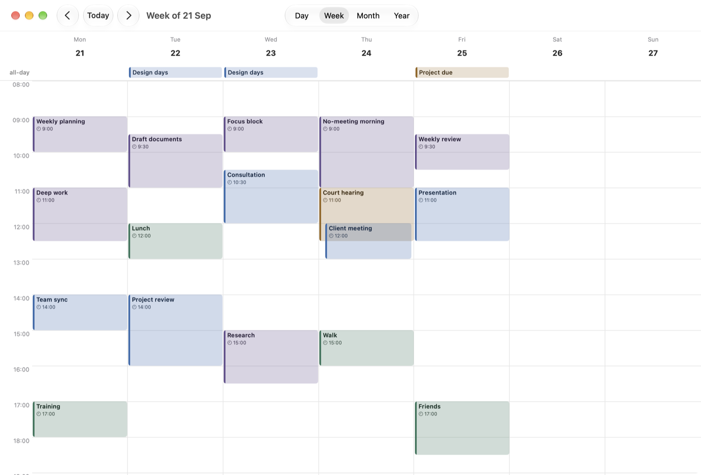
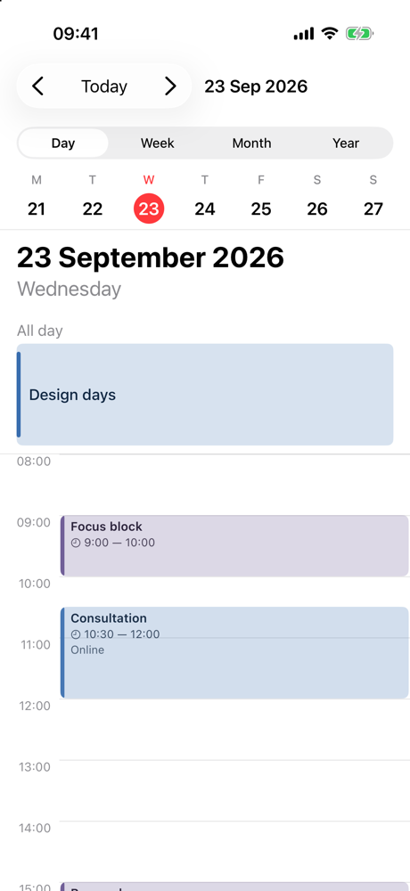
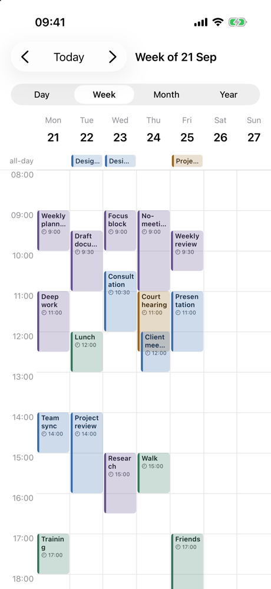
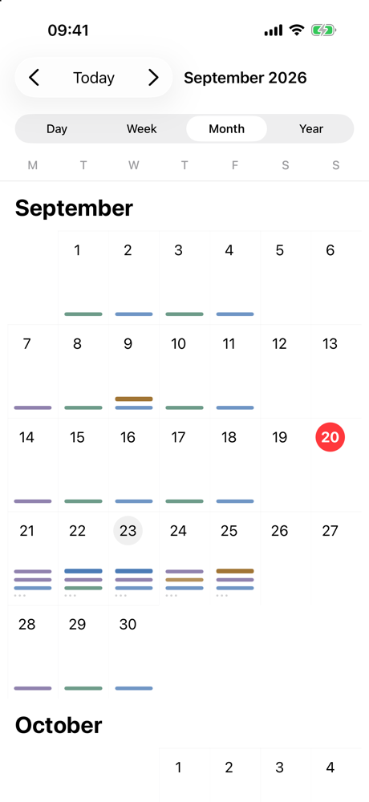
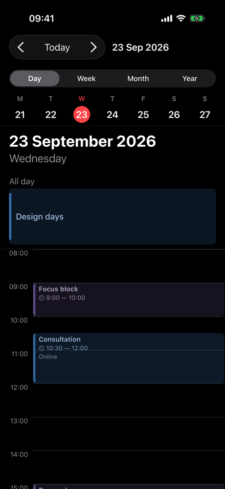
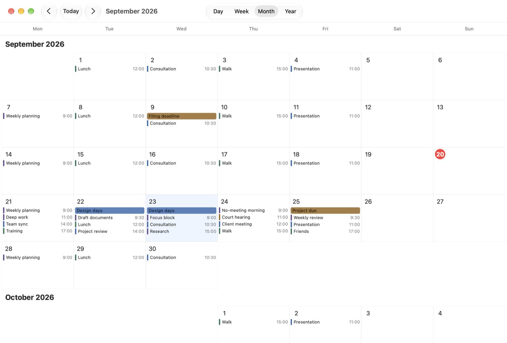
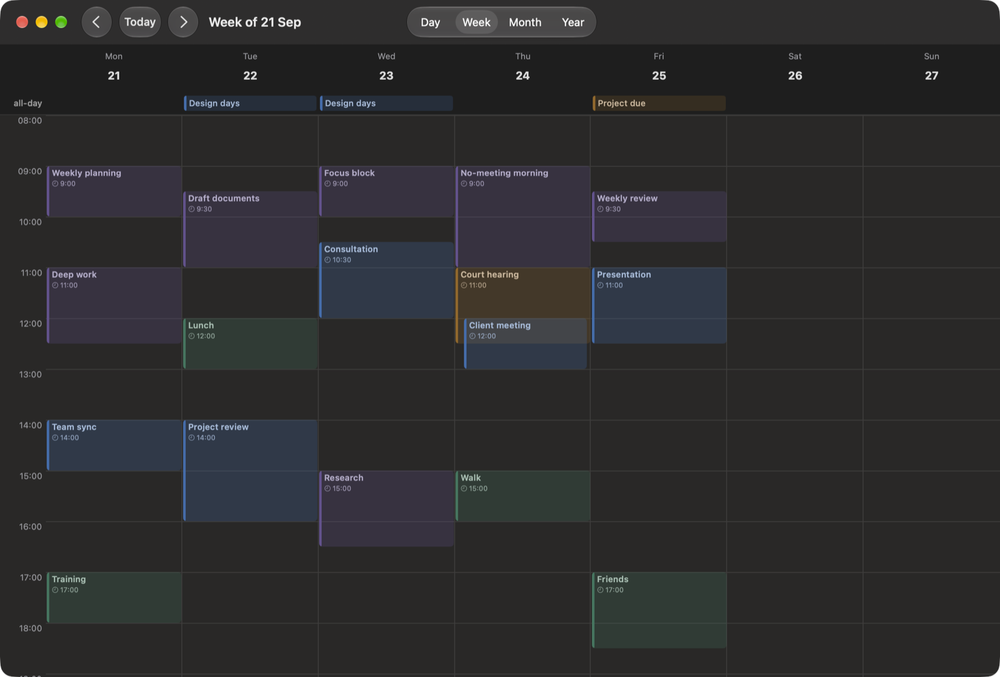

# Kalends

SwiftUI calendar views for iOS and macOS with event layout and drag-and-drop. The host owns storage, sync, and editing.

[](https://swift.org)
[](#requirements)
[](#installation)
[](LICENSE)
[](https://github.com/lawlabs/kalends-swiftui/actions/workflows/ci.yml)

Kalends is the calendar engine behind [LawMatic Calendar](https://github.com/lawlabs/lawmatic-calendar-apple), by [LawLabs](https://github.com/lawlabs). The same views exist for Windows in [Kalends.WinUI](https://github.com/lawlabs/kalends-winui).



<p align="center">
  
  
  
  
</p>

## Features

- **Day, week, month, year** — plus `KalendsView`, one view that switches between them, and `MiniCalendarView` for a sidebar.
- **Drag and drop** — move events in time and, in the week view, across days; resize from either edge; 15-minute snap with a live time badge.
- **Create by gesture** — double-tap empty space for a new event, drag on empty space to draw one.
- **Overlap layout** — events whose titles would collide sit side by side; an event starting inside a longer one is cascaded so both titles stay readable. The algorithm is a public, testable `EventLayoutCalculator`.
- **Touch and desktop styles** — compact month and year views for iPhone and iPad, detailed (event titles, “+N more”) and card styles for the Mac, picked automatically.
- **Host-owned data** — your model conforms to `KalendsEvent`; Kalends never stores or edits anything. No providers, sync or persistence types.
- **Locale-aware** — weekday order from the calendar's first weekday, dates and text from the SwiftUI `\.locale` (English and Russian strings included), light and dark mode.
- **Swift 6** — strict concurrency, `Sendable` model types, zero dependencies.

## Requirements

- iOS 18 / macOS 15
- Swift 6.0 (Xcode 16)

## Installation

Swift Package Manager:

```swift
dependencies: [
    .package(url: "https://github.com/lawlabs/kalends-swiftui.git", from: "0.1.0"),
],
targets: [
    .target(name: "MyApp", dependencies: ["Kalends"]),
]
```

Or in Xcode: File ▸ Add Package Dependencies… and paste the repository URL.

## Quick Start

Conform your event to `KalendsEvent` — or map your records to a small display value, as the sample does:

```swift
import Kalends
import SwiftUI

struct Meeting: KalendsEvent {
    let id: UUID
    var title: String
    var startDate: Date
    var endDate: Date          // exclusive
    var isAllDay: Bool = false
    var color: Color = .blue
    var isReadOnly: Bool = false
    var subtitle: String? = nil
}
```

Hand the views a data source and a date:

```swift
struct ContentView: View {
    @State private var store = KalendsEventStore<Meeting>(events: sampleMeetings)
    @State private var date = Date()
    @State private var mode: KalendsMode = .week

    var body: some View {
        KalendsView(mode: mode, source: store, selectedDate: $date)
    }
}
```

`KalendsEventStore` is an in-memory `KalendsDataSource`; a real app conforms its own repository (`events(on:)`, `hasEvents(on:)`). An `@Observable` source redraws the views when its data changes.

## Handling User Interaction

Kalends reports intent through `KalendsActions`; every callback has a no-op default.

```swift
KalendsView(
    mode: mode,
    source: store,
    selectedDate: $date,
    selectedEventID: selectedID,
    actions: KalendsActions(
        selectEvent: { selectedID = $0.id },
        clearSelection: { selectedID = nil },
        rescheduleEvent: { meeting, interval in
            var moved = meeting
            moved.startDate = interval.start
            moved.endDate = interval.end
            store.upsert(moved)
        },
        createEvent: { start in
            store.upsert(Meeting(id: UUID(), title: "New event", startDate: start, endDate: start + 3600))
        },
        updateDraft: { interval in /* create or update a draft while the user drags */ },
        openDay: { day in date = day; mode = .day }
    )
)
```

Events with `isReadOnly == true` are drawn but cannot be moved or resized.

## Customization

- **Styles** — `DayView(style: .compact)` adds a week strip; `MonthView(style: .detailed)` lists titles with a “+N more” popover; `YearView(style: .cards)`. `.automatic` picks the touch style on iOS and the desktop style on macOS.

  

- **Dark mode** — colors derive from the event color and the system appearance.

  
- **Hour height** — `hourHeight:` on the day and week views.
- **Locale and calendar** — set `.environment(\.locale, …)` and `.environment(\.calendar, …)` on any ancestor; weekday order follows `calendar.firstWeekday`.
- **Layout** — call `EventLayoutCalculator.layout(for:on:containerWidth:hourHeight:configuration:)` yourself to draw events in your own grid.

## Day classification and weekends

Supply production-calendar information from the host's in-memory data. The same
configuration applies to `KalendsView`, individual day/week/month/year views and
`MiniCalendarView` through the SwiftUI environment:

```swift
let calendar = Calendar.current
let date = calendar.date(from: DateComponents(year: 2026, month: 12, day: 31))!
// Illustrative host data, not a country-specific holiday rule.
let days = [date: KalendsDayInfo(kind: .transferredDayOff, description: "Day off moved from another date")]

KalendsView(mode: mode, source: store, selectedDate: $selectedDate)
    .kalendsDays(KalendsDayConfiguration(
        showWeekends: true,
        highlightWeekends: true,
        highlightHolidays: true,
        showWorkingDayMarkers: true,
        dayInfoProvider: { day in days[day] }
    ))
```

The provider runs on the main actor and receives the start of day in the view's
`\.calendar`. Return `nil` to fall back to Saturday/Sunday; return `.working`
or `.transferredWorking` to override a weekend date. The lookup must be fast and
synchronous; keep storage and networking in the host. Observable data read by the
provider participates in SwiftUI updates; results are not cached across updates.

`isShortened` can accompany either working kind. A working transfer never receives
non-working shading. Localized markers complement color, and date tooltips and
accessibility values explain each status even when highlights are off. A custom
`description` replaces the generated explanation. English and Russian are included.

All switches default to `true`. `highlightWeekends`, `highlightHolidays` and
`showWorkingDayMarkers` only change presentation. `showWeekends` hides the
Saturday/Sunday columns in week/month and the compact day strip, independently of
the resolved statuses. Year and sidebar calendars retain all seven days for
navigation. Hidden dates' events remain in the source. No production-calendar
dataset is bundled.

## Example App

`Example/KalendsExample.xcodeproj` runs on iPhone, iPad and Mac with the same week of sample events as the Kalends.WinUI sample: switch modes, drag events around, draw new ones. It builds from a clean clone; to run on a device, pick your team under Signing & Capabilities. The project is generated from `Example/project.yml` with [XcodeGen](https://github.com/yonaskolb/XcodeGen).

Launch arguments, e.g. for screenshots: `-mode week`, `-date 2026-09-23`, `-colorScheme dark`.

## Roadmap

See [ROADMAP.md](ROADMAP.md): parity with Kalends.WinUI (one layout algorithm and shared fixtures, agenda view, spanning all-day bars), customization points, zoomable time scale, snapshot tests, DocC.

## License

MIT — see [LICENSE](LICENSE).
